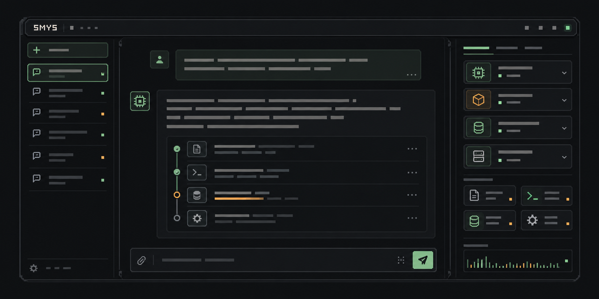

# SMYS



SMYS — локальная модульная AI-платформа с Web UI и CLI. Оба интерфейса используют общий Application API и SQLite-хранилище. Через Web UI можно добавлять OpenAI-compatible endpoints, выбирать модель для сессии и начинать следующий ход без перезапуска host.

Реализован единый OpenAI-compatible Chat Completions adapter, а не отдельная интеграция под каждый сервер. Поэтому LM Studio, Ollama и облачный API вроде OpenAI можно подключить, если endpoint поддерживает совместимые `/v1/chat/completions` и формат запросов/ответов. LM Studio также сохраняет legacy adapter для совместимости. Сам факт поддержки протокола не гарантирует, что конкретная модель умеет streaming, tool calling или reasoning; обнаружение моделей не подтверждает эти capabilities.

## Quick Start

Требуются Node.js 20+ и npm. Для локальной модели сначала запустите LM Studio или Ollama и подготовьте модель.

### Запуск SMYS

В первом терминале из корня проекта:

```sh
npm install
npm install --prefix src/apps/web
npm run web:host
```

Во втором терминале:

```sh
npm run --prefix src/apps/web dev
```

Откройте адрес Vite, напечатанный в терминале (обычно `http://127.0.0.1:5173`). По умолчанию используется Fake provider.

### Подключение модели

Добавьте provider через кнопку **«Модели»** в composer. Укажите имя, Base URL и при необходимости API key. Проверьте подключение, обнаружьте модели или введите точный Model ID вручную. Выберите модель в composer для текущей сессии либо задайте global default. Изменение применяется к следующему ходу и сохраняется в SQLite.

| Provider | Что запустить / подготовить | Base URL в SMYS | Model ID |
| --- | --- | --- | --- |
| LM Studio | Загрузить модель и включить Local Server в Developer tab | `http://localhost:1234/v1` | Выбрать из обнаруженных или указать ID LM Studio |
| Ollama | `ollama pull llama3.2`; убедиться, что Ollama server запущен | `http://localhost:11434/v1` | Точное имя из `ollama list`, например `llama3.2` |
| OpenAI API | Создать API key у провайдера | `https://api.openai.com/v1` | Точный ID доступной модели |
| Другой OpenAI-compatible API | Взять Base URL и Model ID из документации провайдера | Например, `https://openrouter.ai/api/v1` | Точный ID модели у провайдера |

Если endpoint не поддерживает `GET /models` или нужного ID нет в списке, добавьте его вручную. На macOS ключ хранится в Keychain и не передаётся обратно в браузер. На других платформах сохранение ключей сейчас не поддерживается; можно использовать endpoint без авторизации.

Для подробностей совместимости см. документацию [LM Studio](https://lmstudio.ai/docs/developer/openai-compat) и [Ollama](https://docs.ollama.com/api/openai-compatibility).

## Данные чатов и CLI

Чаты, сообщения и завершённые run traces хранятся в SQLite: по умолчанию это `.smys-agent/store.sqlite` относительно каталога запуска host. `SMYS_DATA_DIR` задаёт общий каталог для Web и CLI. API keys хранятся отдельно в macOS Keychain, в SQLite лежат только ссылки на них.

Настроенные providers и models тоже сохраняются в этой SQLite базе (`provider_configs` и `model_configs`). Основной интерфейс управления — Web UI; отдельных CLI-команд для добавления или редактирования каталога нет. Для локальных скриптов доступны management routes Web API, например `POST /api/providers`, `POST /api/models`, test и discovery routes. Host должен быть запущен и принимает такие запросы только через loopback; если запрос содержит `Origin`, он должен совпадать с loopback host. CORS выключен. Для API key используйте этот API, чтобы host передал secret в Keychain; не записывайте его вручную в SQLite. Маршруты перечислены в [контрактах](docs/CONTRACTS.md).

При первом создании SQLite-хранилища SMYS однократно импортирует существующий legacy `store.json` формата v1/v2/v3 и сохраняет рядом исходный файл как `store.json.vN.sqlite.bak`. Это миграция старого формата, а не общий импорт чатов. Полноценного импорта/экспорта всех чатов через UI или CLI пока нет.

Можно вывести сообщения одной сессии в JSON и перенаправить их в файл:

```sh
npm run --silent cli -- history get --json --session-id <SESSION_ID> > chat.json
```

Это выгрузка списка сообщений одной сессии, без run traces; файл нельзя импортировать обратно через CLI. Для ручной резервной копии чатов и SQLite-конфигурации остановите Web Host и CLI-процессы и скопируйте `store.sqlite` из каталога данных. API keys в эту копию не входят: они находятся в Keychain.

### CLI

CLI — headless интерфейс к тому же Application API и SQLite-хранилищу, рассчитанный на терминал, скрипты и автоматизацию. Это не полноценная замена Web UI: CLI не управляет каталогом providers/models, не даёт выбирать сессии из списка и не показывает сохранённую траекторию run. Provider и модели настраиваются в Web; CLI использует сохранённый выбор либо принимает одноразовый `--model-config-id`.

Основные команды: создать сессию, добавить пользовательское сообщение без запуска модели, выполнить ход и прочитать сообщения сессии. Пример:

```sh
npm run --silent cli -- session create --json --initial-message "Привет"
npm run --silent cli -- agent run --json --session-id <SESSION_ID> --text "Продолжи разговор"
npm run --silent cli -- history get --json --session-id <SESSION_ID>
```

Ответы поддерживают обычный текст или `--json`; ход можно выводить потоково через `--stream`, а для обработки событий скриптом — `--stream --output ndjson`. `history get` возвращает сообщения, но не run traces. Доступен встроенный `demo.add`, только если явно подключить и разрешить его флагами `--tool demo.add --allow-tool demo.add`. Старые `--provider fake|lm-studio` и env-настройки остаются fallback. Полные команды, JSON-контракт и коды выхода — в [контрактах](docs/CONTRACTS.md).

## Документация

- [Текущий статус и evidence](docs/NOW.md)
- [Архитектура](docs/ARCHITECTURE.md)
- [Контракты Web API, CLI и хранения](docs/CONTRACTS.md)
- [Решение ADR-0017 о providers и models](docs/DECISIONS/ADR-0017-provider-model-configuration.md)
- [Roadmap](docs/ROADMAP.md)
