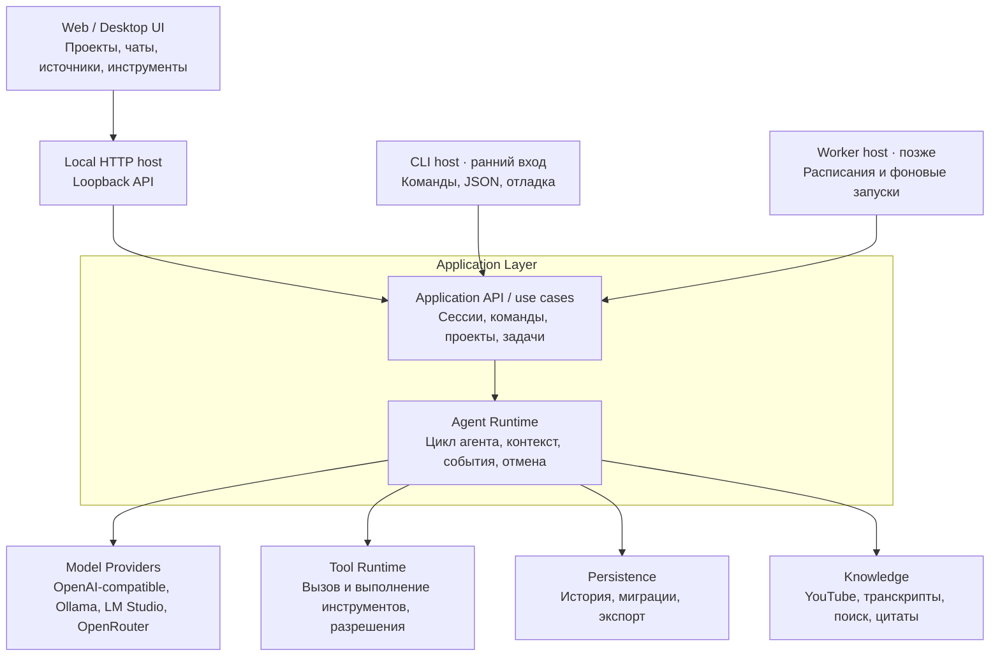

# Architecture

**Статус:** документ разделяет текущую реализацию и целевые направления. Внутренний application API и headless-first вход утверждены в ADR-0001. Целевые схемы ниже не означают, что описанные модули, пути или контракты уже реализованы.

## Текущая реализация

В репозитории реализованы два host: CLI напрямую вызывает application use cases, а браузерный Web-клиент обращается к тем же use cases через локальный HTTP host. Application сохраняет пользовательское сообщение, core получает ответ provider, application сохраняет финальный ответ, а JSON-хранилище позволяет восстановить историю после перезапуска. Web может читать текстовые чанки через SSE; финальный ответ сохраняется один раз после корректного окончания генерации. Core/application также реализуют ограниченный цикл с одним переданным инструментом и проверкой разрешений. Runtime передаёт типизированные события модели и инструментов в Application callback; Application сообщает lifecycle после записи сообщений. Эти события временные и пока не входят в HTTP-контракт. CLI по умолчанию не передаёт tools; `demo.add` подключается явными флагами.

```text
src/apps/cli/{demo-tools,main,smoke-lm-studio}.ts
src/apps/web-host/{main,server}.ts    # локальный HTTP host поверх Application API
src/apps/web/                         # React/Vite клиент с HTTP adapter
src/packages/application/{errors,index,ports,use-cases}.ts
src/packages/core/agent/{errors,index,model,runtime,tool}.ts
src/packages/core/session.ts
src/packages/providers/{fake-provider,lm-studio-provider}.ts
src/packages/storage/{errors,index,json-file-session-repository,store-format}.ts
src/tests/{application,cli,providers,storage,web-host}/
docs/
```

`src/apps/web` показывает реальные сессии и сообщения из Application API. Vite проксирует `/api` в `src/apps/web-host`; host вызывает Application use cases и выбирает Fake или LM Studio. Проекты и agent event streaming пока не реализованы: группа сессий называется «Без проекта», а вкладка истории показывает только сохранённые сообщения. Текущий текстовый поток является временным UI-состоянием; reasoning и tool calls не выдаются за сохранённую trajectory. Web host сериализует изменяющие HTTP-запросы в одном процессе; CLI не должен одновременно записывать тот же JSON store. Детали API, ошибок и формата данных находятся в [CONTRACTS.md](CONTRACTS.md).

## Целевая модель

Один модульный монолит с единым application layer и строгими границами ответственности. Не микросервисы и не набор абстрактных слоёв. CLI вызывает Application in-process; браузер использует небольшой HTTP transport host из-за границы браузер/Node. UI и CLI принимают команды, agent runtime управляет ходом агента, а адаптеры связывают его с моделями, инструментами, хранилищем и знаниями.



Диаграмма объединяет реализованные и целевые роли. Web HTTP host и CLI подключены; названия provider кроме Fake/LM Studio остаются примерами, а не выбранными интеграциями. Worker и Desktop host остаются будущими сценариями.

## Структура модулей и возможное расширение

```text
.
├── src/
│   ├── apps/
│   │   ├── cli/                          # реализованный host
│   │   ├── web-host/                     # реализованный loopback HTTP host
│   │   └── desktop/                      # будущий host
│   ├── packages/
│   │   ├── application/                  # use cases и порты
│   │   ├── core/                         # runtime и сущности сессии
│   │   ├── providers/                    # fake и LM Studio adapters
│   │   └── storage/                      # JSON-файловый adapter
│   ├── plugins/                          # будущие интеграции
│   └── tests/                            # application, CLI, providers, storage
└── docs/
```

Каталоги `src/apps/desktop/` и `src/plugins/` показаны как возможные будущие направления и пока не созданы. `src/packages/application/` сохранён как отдельная граница use cases. Tool-calling пока не выделен в отдельный пакет; YouTube-плагин не реализован. Текущее хранилище — версионируемый JSON-файл; SQLite не выбран.

## Целевые ответственности модулей

Таблица описывает границы реализованных и будущих модулей.

| Модуль | Отвечает за | Не должен знать |
| --- | --- | --- |
| UI (`src/apps/desktop`) | Отображение состояния; пользовательский ввод; отправку команд | Внутренности цикла агента, SQL и формат API конкретной модели |
| Web UI (`src/apps/web`) | Отображение реальных сессий и сообщений; пользовательский ввод; HTTP-запросы | Application/Core imports, provider config, JSON storage и выдуманные runtime events |
| Web host (`src/apps/web-host`) | HTTP transport, provider/data-dir config, сериализация изменяющих запросов | Собственный agent loop и UI-компоненты |
| CLI (`src/apps/cli`) | Headless-команды, скриптовое управление, структурированный вывод и коды завершения | Собственную реализацию agent loop, прямое управление БД и обход проверок разрешений |
| Application API (`src/packages/application`) | Создание проектов и сессий; команды чата и задач; связывание входов с runtime и портами | UI-компоненты, транспорт HTTP и детали сетевого протокола провайдера |
| Core / Agent Runtime | Ход сессии, сбор контекста, ответы модели, вызовы инструментов, события и отмена | React, SQLite, OpenRouter, YouTube и другие конкретные адаптеры |
| Providers | Преобразование внутреннего запроса в формат модели и нормализация ответа обратно | UI, хранение чатов и бизнес-логика приложения |
| Tools | Регистрация и выполнение инструментов; проверка разрешений до побочного эффекта | Представление UI и внутренний формат API модели |
| Storage | Запись, чтение, миграции и экспорт сохранённых данных | Правила цикла агента и детали провайдеров |
| Knowledge | Получение и поиск источников, выдача контекста и ссылок/цитат | Внутренности UI и конкретная реализация agent loop |

## Целевое направление зависимостей

- Web UI вызывает локальный HTTP host; host преобразует HTTP-запросы в Application use cases. CLI вызывает те же use cases in-process.
- Application layer использует core и порты инфраструктуры.
- Core зависит от внутренних типов и интерфейсов портов; конкретные адаптеры подключаются снаружи.
- Provider adapter реализует порт модели; storage adapter реализует порты чтения/записи; tool runtime реализует реестр/исполнение инструментов с проверкой разрешений.
- Внешние источники данных подключаются через явную границу; конкретная форма подключения YouTube пока не выбрана.
- Адаптеры не импортируют UI. Core не импортирует SDK провайдера, драйвер SQLite или реализацию конкретного источника/инструмента.

Практическая проверка границ: смена SQLite не меняет agent loop; смена провайдера не переписывает чат; смена UI не меняет историю или runtime.

## Application API и входы: текущее и будущее

Текущий `src/packages/application` предоставляет `createSession`, `listSessions`, `sendMessage`, `runAgentTurn`, `runAgentTurnStreaming` и `getHistory`. Это внутренняя граница use cases; тесты могут вызывать её напрямую с fake provider и тестовым хранилищем. Потоковый use case принимает текстовые чанки через callback, поддерживает отмену и не сохраняет частичный ответ. `createProject` и `replaySession` не реализованы.

- CLI — headless host для создания сессий, отправки сообщений и чтения истории. Он вызывает application API, поддерживает JSON-вывод и стабильные коды завершения.
- Web host предоставляет `GET /api/sessions`, `POST /api/sessions`, `GET /api/sessions/:id/history`, `POST /api/sessions/:id/messages` и `POST /api/sessions/:id/messages/stream`. Последний использует SSE и `runAgentTurnStreaming`; отмена запроса передаётся provider.
- Web host по умолчанию использует Fake provider; LM Studio настраивается переменными окружения. Host слушает `127.0.0.1`, а Vite проксирует браузерные API-запросы.
- Worker отложен до фонового сценария. Он должен вызывать те же use cases, а не реализовывать собственный цикл агента.
- Сейчас есть unit/integration-тесты application, storage и providers, а также CLI process-тесты. CLI проверяет реальный процесс и постоянное хранилище между запусками.
- HTTP host сериализует все изменяющие API-запросы одного процесса. Конкурентная запись из CLI/другого процесса в тот же JSON store не гарантируется.

Команды `provider test`, `eval`, `trace`, `serve` и scheduler не реализованы. Текущий HTTP host обслуживает только локальный Web-клиент; расширение API для сетевых клиентов требует отдельного решения.

## Ограниченный agent loop

```text
application сохраняет user message
  → runtime передаёт историю и доступный инструмент provider
  → provider возвращает финальный текст или один tool call
  → runtime проверяет имя и аргументы, получает allow
  → инструмент выполняется, результат добавляется во временный контекст
  → runtime вызывает provider ещё раз без доступных tools
  → application сохраняет только финальный assistant message
```

В реализованном срезе за ход можно передать максимум один инструмент. Runtime делает максимум два вызова модели и один вызов инструмента. Он проверяет имя и аргументы, затем запрашивает разрешение; выполнение происходит только при явном `allow`. Неизвестный инструмент, неверные аргументы, отказ, сбой инструмента или provider и превышение лимита завершают ход без финального сообщения ассистента.

Application API сохраняет сообщение пользователя, передаёт историю runtime и сохраняет только финальный текст ассистента. Reasoning возвращается отдельно как временный результат хода, показывается CLI и не сохраняется в истории. Через `AgentEvent` Runtime сообщает границы каждого вызова модели, reasoning по вызовам, запрос инструмента, начало разрешённого исполнения и его результат. Application сообщает `turn.started` после записи user message, `turn.completed` после записи assistant message и `turn.failed` при ошибке. Tool call и результат по-прежнему живут во временном контексте модели. При ошибке остаётся пользовательское сообщение без ответа ассистента. Fake provider позволяет детерминированно проверить цепочку «tool call → результат → финальный ответ». LM Studio преобразует один OpenAI-compatible вызов функции и промежуточную пару assistant/tool. CLI передаёт пустой список tools по умолчанию; с `--tool demo.add` добавляет только встроенный инструмент, а исполнение разрешает только с отдельным `--allow-tool demo.add`.

Хранилище v2 допускает сообщения `user` и `assistant`. Валидный v1 читается без изменения файла и мигрируется при первой записи; исходник сохраняется как `store.json.v1.bak` до атомарной замены. Неизвестный и повреждённый формат отклоняется без автоматического сброса.

## Record/replay (целевое направление, не реализовано)

Запись упорядоченных событий сессии и воспроизведение через fake provider и mock-инструменты могут дать детерминированную проверку agent loop. Это направление не реализовано. Формат событий, payload, маскирование секретов и совместимость требуют отдельного решения.

## Целевые проверки

Текущий набор содержит тесты для application use cases, JSON storage, providers и CLI-процессов. Эта документация не утверждает, что они проходили в текущем запуске. Для будущего agent loop живые модели не нужны в основном детерминированном наборе; smoke-проверки providers выполняются отдельно.

| Уровень | Пример проверки |
| --- | --- |
| Unit | Application API с scripted fake provider выполняет один разрешённый вызов тестового инструмента и сохраняет только финальный ответ; отказ и лимиты не запускают повторное исполнение. |
| Contract | LM Studio adapter преобразует текстовую историю и один tool call в Chat Completions request и проверяет ответ. |
| Integration | Полная история сессии сохраняется и восстанавливается после перезапуска приложения. |
| Web API | Fake provider: создать сессию, выполнить turn, перечитать историю; ошибка provider сохраняет user message и возвращает статус хода. |
| CLI process | Один CLI-процесс выполняет ход через fake provider или локальную HTTP-заглушку LM Studio; следующий процесс читает сообщения пользователя и ассистента в том же порядке. |
| Replay | Формат событий и воспроизведение хода остаются будущим сценарием. |
| E2E | Можно создать сессию в Web, отправить сообщение, получить ответ и восстановить переписку после перезагрузки страницы. |
| Security | Запрещённая команда не исполняется без нужного решения permission policy. |

Дополнительно проверяются прерывание streaming, сетевые ошибки, некорректный tool call, закрытие приложения во время операции, миграции БД, повторная отправка сообщения и восстановление после сбоя. Такие сценарии должны опираться на управляемые fake зависимости там, где это возможно.
