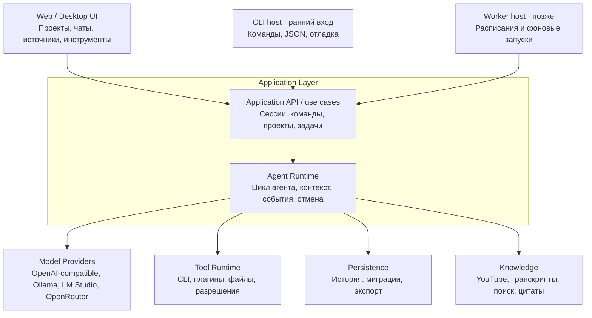

# Architecture

**Статус:** целевая архитектура модульного монолита с портами и адаптерами. Headless-first направление и внутренний application API утверждены в ADR-0001; остальные технологии и будущие публичные контракты не считаются утверждёнными только на основании этого документа.

## Модель в голове

Один модульный монолит с единым application layer и строгими границами ответственности. Не микросервисы и не набор абстрактных слоёв. Каждый host вызывает application API в своём процессе; отдельный HTTP-сервер для этого не нужен. UI и CLI принимают команды, agent runtime управляет ходом агента, а адаптеры связывают его с моделями, инструментами, хранилищем и знаниями.



Провайдеры, названия вендоров и технологии на диаграмме — примеры направлений адаптеров, не решение о выбранном поставщике или библиотеке. `apps/cli` — ранний headless host для проверки и ручного управления. Web/Desktop UI и `apps/worker` добавляются по мере реализации соответствующих сценариев. Способ упаковки desktop UI остаётся открытым.

## Предлагаемое дерево

```text
my-harness/
├── apps/
│   ├── cli/
│   │   └── src/main.ts
│   └── web/
│   # worker/ добавляется с фоновыми расписаниями
├── packages/
│   ├── application/
│   │   ├── ports.ts
│   │   └── use-cases.ts
│   ├── core/
│   │   ├── agent-loop.ts
│   │   ├── session.ts
│   │   └── events.ts
│   ├── providers/
│   │   ├── openai-compatible.ts
│   │   └── provider-types.ts
│   ├── tools/
│   │   ├── registry.ts
│   │   ├── executor.ts
│   │   └── permissions.ts
│   ├── storage/
│   │   ├── json-file-session-repository.ts
│   │   ├── store-format.ts
│   │   └── migrations/
│   └── knowledge/
│       ├── sources.ts
│       └── retrieval.ts
├── plugins/
│   └── youtube/
├── tests/
│   └── fixtures/
└── docs/
```

Это целевая раскладка по ответственности; модули появляются вместе со сквозными сценариями. Ранний исполняемый срез включает `apps/cli`, `packages/application`, `packages/core` и нужный адаптер хранения. `application/` выделяет входные операции/use cases отдельно от agent runtime. Текущий срез использует версионируемый JSON-файл через `json-file-session-repository.ts`; SQLite не выбран.

## Ответственность модулей

| Модуль | Отвечает за | Не должен знать |
| --- | --- | --- |
| UI (`apps/web`, desktop host) | Отображение состояния; пользовательский ввод; отправку команд | Внутренности цикла агента, SQL и формат API конкретной модели |
| CLI (`apps/cli`) | Headless-команды, скриптовое управление, структурированный вывод и коды завершения | Собственную реализацию agent loop, прямое управление БД и обход проверок разрешений |
| Application API / application layer | Создание проектов и сессий; команды чата и задач; связывание входов с runtime и портами | UI-компоненты, транспорт HTTP и детали сетевого протокола провайдера |
| Core / Agent Runtime | Ход сессии, сбор контекста, ответы модели, вызовы инструментов, события и отмена | React, SQLite, OpenRouter, YouTube и другие конкретные адаптеры |
| Providers | Преобразование внутреннего запроса в формат модели и нормализация ответа обратно | UI, хранение чатов и бизнес-логика приложения |
| Tools | Регистрация и выполнение инструментов; проверка разрешений до побочного эффекта | Представление UI и внутренний формат API модели |
| Storage | Запись, чтение, миграции и экспорт сохранённых данных | Правила цикла агента и детали провайдеров |
| Knowledge | Получение и поиск источников, выдача контекста и ссылок/цитат | Внутренности UI и конкретная реализация agent loop |
| Plugins | Подключаемая реализация источника знаний или возможностей | Прямое изменение внутренних правил core |

## Направление зависимостей

- UI вызывает application layer через команды и подписывается на состояние/события.
- Application layer использует core и порты инфраструктуры.
- Core зависит от внутренних типов и интерфейсов портов; конкретные адаптеры подключаются снаружи.
- Provider adapter реализует порт модели; storage adapter реализует порты чтения/записи; tool runtime реализует реестр/исполнение инструментов с проверкой разрешений.
- Knowledge sources подключаются через собственные интерфейсы; YouTube — источник/плагин, а не особое знание core.
- Адаптеры не импортируют UI. Core не импортирует SDK провайдера, драйвер SQLite или код конкретного плагина.

Практическая проверка границ: смена SQLite не меняет agent loop; смена провайдера не переписывает чат; смена UI не меняет историю или runtime.

## Application API и входы

`packages/application` предоставляет внутренние операции приложения: `createSession`, `sendMessage`, `runAgentTurn` и `getHistory`; далее могут добавиться `createProject` и `replaySession`. Это единая внутренняя граница use cases для разных входов. Application layer связывает команды с core и портами, а тесты могут вызывать её напрямую с fake provider и тестовым хранилищем.

- CLI — ранний headless host и единственный пользовательский вход первого сквозного среза. Команды позволяют создать сессию, сохранить сообщение без модели, выполнить один ход с явным `--provider fake` и прочитать историю. Он вызывает application API, поддерживает JSON-вывод и стабильные коды завершения.
- Web UI вызывает те же use cases через host приложения. Если UI и application layer работают в разных процессах, между ними добавляется HTTP transport adapter.
- Будущий worker запускает те же use cases по расписанию. Он не должен реализовывать отдельный цикл агента.
- Локальные unit/integration тесты запускаются через package scripts и обращаются к application API с подменёнными портами. CLI даёт отдельную проверку через настоящий процесс и постоянное хранилище: CLI сохраняет сообщение, завершается, новый запуск читает историю.
- HTTP API добавляется при появлении удалённого клиента или границы процессов. HTTP-обработчики преобразуют запросы в те же application commands; application layer не зависит от HTTP.

Внутренний application API и минимальный CLI входят в первую исполняемую версию. Команды `provider test`, `eval`, `trace`, `serve`, worker, scheduler и сетевой API добавляются отдельными вертикальными задачами по мере появления потребности.

## Поток одного запроса

```text
Пользователь отправляет сообщение
  → application layer загружает сессию
  → runtime собирает контекст
  → provider adapter вызывает модель
  → runtime получает вызов инструмента от модели
  → tool runtime проверяет разрешение
  → инструмент выполняется
  → результат и события сохраняются
  → runtime передаёт результат модели и продолжает цикл
  → финальный ответ сохраняется
  → UI получает обновлённое состояние
```

Для отказа, отмены, таймаута и неполного ответа поток должен завершаться наблюдаемым событием и сохраняемым состоянием сессии; точная политика повторов и восстановления определяется контрактами и отдельными решениями.

В реализованном минимальном ходе `agent run` application API сохраняет сообщение пользователя, передаёт историю core runtime, получает ровно один текстовый ответ от выбранного provider и сохраняет его как сообщение ассистента. Этот срез не выполняет инструменты и не обращается к сети. Fake provider доступен только при явном `--provider fake`; его ответ детерминирован для проверки истории между CLI-процессами.

Хранилище v2 допускает сообщения `user` и `assistant`. Валидный v1 читается без изменения файла и мигрируется при первой записи; исходник сохраняется как `store.json.v1.bak` до атомарной замены. Неизвестный и повреждённый формат отклоняется без автоматического сброса.

## Record/replay

Запись упорядоченных событий сессии и воспроизведение через fake provider и mock-инструменты — ранняя возможность core. Она позволяет детерминированно проверять обычный цикл, ошибку инструмента, повторный вызов, финальный ответ, восстановление сессии и отображение истории без сетевого обращения к реальной LLM. Формат сохранения полных payload провайдера, маскирование секретов и чувствительных данных требуют отдельного согласования.

## Проверки

Основной набор должен быть детерминированным; настоящая LLM не нужна для проверки логики цикла. Живые smoke-проверки провайдеров запускаются отдельно и не входят в обязательный локальный прогон.

| Уровень | Пример проверки |
| --- | --- |
| Unit | Agent loop завершает работу после финального ответа и корректно обрабатывает отмену. |
| Contract | Адаптер Ollama преобразует внутренний tool call и ответ в ожидаемый формат. |
| Integration | Полная история сессии сохраняется и восстанавливается после перезапуска приложения. |
| CLI smoke | Один CLI-процесс выполняет ход через fake provider; следующий процесс читает пользовательское сообщение и ответ ассистента в том же порядке. |
| Replay | Записанная цепочка «запрос модели → вызов инструмента → ошибка → повтор → финальный ответ» воспроизводится с fake provider и mock-инструментами. |
| E2E | Можно создать проект, отправить сообщение, переключить модель и открыть старый чат. |
| Security | Запрещённая команда не исполняется без нужного решения permission policy. |

Дополнительно проверяются прерывание streaming, сетевые ошибки, некорректный tool call, закрытие приложения во время операции, миграции БД, повторная отправка сообщения и восстановление после сбоя. Такие сценарии должны опираться на управляемые fake зависимости там, где это возможно.
