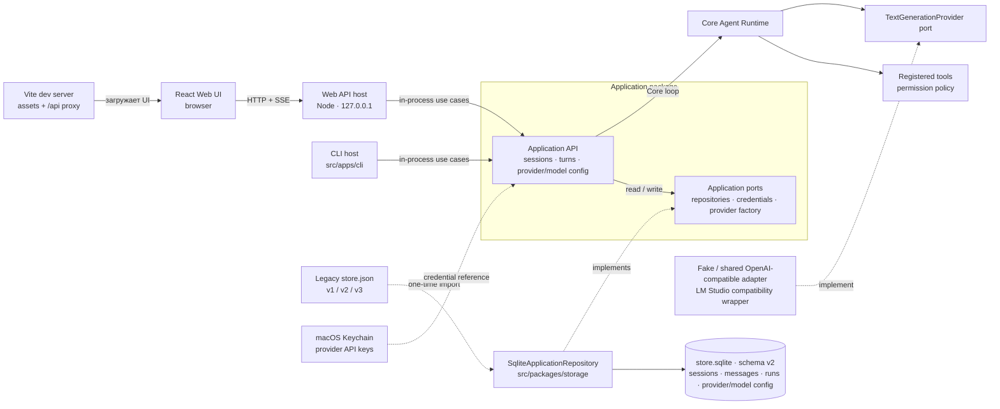
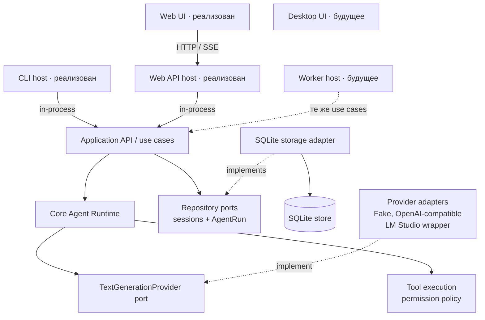

# Architecture

**Статус:** документ разделяет текущую реализацию и целевые направления. Внутренний application API и headless-first вход утверждены в ADR-0001; единое исполнение хода — в ADR-0012; пользовательская конфигурация OpenAI-compatible providers/models — в ADR-0017. Целевые схемы ниже не означают, что описанные модули, пути или контракты уже реализованы.

## Текущая реализация

В репозитории реализованы два host: CLI и Web вызывают один Application use case `executeTurn()` через общий Core loop. Application сохраняет пользовательское сообщение, Core получает ответ provider и при необходимости передаёт текстовые дельты, а после успеха Application атомарно записывает финальный ответ и completed run trace. SQLite позволяет восстановить историю и ordered trajectory после перезапуска. Один цикл поддерживает tool call, reasoning, streaming и отмену. Web SSE передаёт runtime/lifecycle events; CLI поддерживает обычный вывод, `--json`, text streaming и NDJSON. Web подключает `demo.add` только по явному одноходовому разрешению; CLI требует `--tool` и `--allow-tool`.

### Слои текущей реализации



Web UI работает в браузере. В локальном режиме Vite отдаёт его assets и проксирует `/api`; Web API host принимает HTTP/SSE и вызывает Application in-process. CLI вызывает те же use cases напрямую, без HTTP-сервера. Оба host создают SQLite adapter и передают его Application через `ApplicationRepository`; Core не импортирует SQL или драйвер. Старый JSON читается adapter только при первом создании SQLite store.

```text
src/apps/cli/{main,smoke-lm-studio}.ts
src/apps/web-host/{main,server}.ts    # локальный HTTP host поверх Application API
src/apps/web/                         # React/Vite клиент с HTTP adapter
src/apps/web-ui/turn-presentation.ts  # reducer временного event state для Web UI
src/packages/application/{demo-tools,errors,index,ports,provider-configuration,use-cases}.ts
src/packages/core/agent/{errors,index,model,runtime,tool}.ts
src/packages/core/session.ts
src/packages/providers/{fake-provider,lm-studio-provider,macos-credential-store}.ts
src/packages/storage/{errors,index,json-file-session-repository,sqlite-application-repository,store-format}.ts
src/tests/{application,cli,providers,storage,web,web-host}/
docs/
```

`src/apps/web` показывает сессии, сообщения и completed traces из Application API, а также каталог providers/models и выбор модели для сессии. Vite проксирует `/api` в `src/apps/web-host`; host вызывает `executeTurn()` с провайдером, разрешённым Application для нового хода. Fake и legacy env-настройки остаются fallback; пользовательские OpenAI-compatible endpoints используют один Chat Completions adapter, а LM Studio сохраняет совместимый wrapper. Chat размещает status, reasoning/tool events и assistant draft в порядке текущего хода; History раскрывает сохранённые model/tool шаги подробнее. После успешного завершения Application сохраняет ordered trace и фактический provider/model snapshot отдельно от assistant message. API keys хранятся в macOS Keychain; SQLite хранит только opaque reference, браузер получает только признак наличия ключа. Web UI предлагает явный checkbox для grant `demo.add` на один ход. Проекты пока не реализованы: группа сессий называется «Без проекта». JSON v1/v2/v3 импортируется в SQLite один раз; повторный запуск Web Host использует существующую БД. Детали API, ошибок и формата данных находятся в [CONTRACTS.md](CONTRACTS.md).

### Provider и model configuration (ADR-0017)

Конфигурация разделена на три независимых понятия: `ProviderConfig` описывает OpenAI-compatible endpoint и ссылку на credential; `ModelConfig` хранит provider ID, точный Model ID, отображаемое имя, источник `manual | discovered` и capabilities streaming/tool calling/reasoning со значениями `unknown | supported | unsupported`; выбор модели задаётся отдельно для запуска. Эти записи сохраняются в SQLite schema v2 вместе с глобальным default и выбором сессии. CLI и Web используют один store и Application resolver.

Для каждого нового `AgentRun` resolver ищет сохранённый выбор в порядке per-run → session → global. При его наличии Application загружает provider config и credential и создаёт adapter с зафиксированными endpoint и Model ID; без сохранённого выбора host сохраняет legacy env fallback, затем Fake provider. Выбор не меняет уже выполняющийся Run; завершённый `AgentRun` сохраняет provider/model snapshot для истории. Discovery через `/models` получает список Model IDs, но оставляет capabilities `unknown`: наличие модели не подтверждает поддержку reasoning, tools или streaming. Пользователь может добавить точный Model ID вручную.

Web UI управляет каталогом только через локальный HTTP host, который вызывает Application use cases; UI и CLI не обращаются к SQLite напрямую. Проверка и discovery адресуют сохранённый provider по ID. API key принимается host, хранится в macOS Keychain и никогда не возвращается клиенту; SQLite содержит только credential reference. Нет plaintext fallback. Host ограничен loopback, проверяет same-host loopback Origin, не включает CORS; удалённый HTTP endpoint требует явного согласия. Изменение host, provider factory или vault не создаёт отдельный agent loop и не меняет Core runtime.

## Целевая модель

Один модульный монолит с единым application layer и строгими границами ответственности. Не микросервисы и не набор абстрактных слоёв. CLI вызывает Application in-process; браузер использует небольшой HTTP transport host из-за границы браузер/Node. UI и CLI принимают команды, agent runtime управляет ходом агента, а адаптеры связывают его с моделями, инструментами, хранилищем и знаниями.



Здесь сплошными связями показан текущий путь Web и CLI; пунктир означает будущую роль. Desktop UI и Worker пока не реализованы. Persistence подключается к Application через repository port, а Core работает с provider/tool interfaces и не зависит от конкретного storage adapter.

## Структура модулей и возможное расширение

```text
.
├── src/
│   ├── apps/
│   │   ├── cli/                          # реализованный host
│   │   ├── web-host/                     # реализованный loopback HTTP host
│   │   └── desktop/                      # будущий host
│   ├── packages/
│   │   ├── application/                  # use cases и порты
│   │   ├── core/                         # runtime и сущности сессии
│   │   ├── providers/                    # fake и LM Studio adapters
│   │   └── storage/                      # SQLite adapter и JSON importer
│   ├── plugins/                          # будущие интеграции
│   └── tests/                            # application, CLI, providers, storage
└── docs/
```

Каталоги `src/apps/desktop/` и `src/plugins/` показаны как возможные будущие направления и пока не созданы. `src/packages/application/` сохранён как отдельная граница use cases. Tool-calling пока не выделен в отдельный пакет; YouTube-плагин не реализован. Активное хранилище — SQLite; JSON v1/v2/v3 используется только для однократного импорта.

## Целевые ответственности модулей

Таблица описывает границы реализованных и будущих модулей.

| Модуль | Отвечает за | Не должен знать |
| --- | --- | --- |
| Desktop UI (будущее, `src/apps/desktop`) | Отображение состояния; пользовательский ввод; отправку команд | Внутренности цикла агента, SQL и формат API конкретной модели |
| Web UI (`src/apps/web`, `src/apps/web-ui`) | Отображение сессий, сообщений и run state; пользовательский ввод; HTTP/SSE-запросы | Application/Core imports, provider config, storage schema и выдуманные runtime events |
| Web host (`src/apps/web-host`) | HTTP transport, legacy env/data-dir config, local-origin checks, сериализация изменяющих запросов | Собственный agent loop и UI-компоненты |
| CLI (`src/apps/cli`) | Headless-команды, скриптовое управление, структурированный вывод и коды завершения | Собственную реализацию agent loop, прямое управление БД и обход проверок разрешений |
| Application API (`src/packages/application`) | Сессии, сообщения, completed turns и trajectory; provider/model configuration use cases; разрешение модели перед Run и связывание входов с runtime/ports | UI-компоненты, транспорт HTTP и детали сетевого протокола провайдера |
| Core / Agent Runtime | Ход сессии, сбор контекста, ответы модели, вызовы инструментов, события и отмена | React, SQLite, OpenRouter, YouTube и другие конкретные адаптеры |
| Providers | Преобразование внутреннего запроса в формат модели и нормализация ответа обратно; общий OpenAI-compatible adapter и credential vault adapter | UI, хранение чатов и бизнес-логика приложения |
| Tools | Регистрация и выполнение инструментов; проверка разрешений до побочного эффекта | Представление UI и внутренний формат API модели |
| Storage (`src/packages/storage`) | Сохранение sessions/messages/runs и provider/model configuration в SQLite; schema init и однократный JSON import | Правила цикла агента и детали провайдеров |
| Knowledge | Получение и поиск источников, выдача контекста и ссылок/цитат | Внутренности UI и конкретная реализация agent loop |

## Целевое направление зависимостей

- Web UI вызывает локальный HTTP host; host преобразует HTTP-запросы в Application use cases. CLI вызывает те же use cases in-process.
- Application layer использует core и порты инфраструктуры.
- Core зависит от внутренних типов и интерфейсов портов; конкретные адаптеры подключаются снаружи.
- Provider adapter реализует порт модели; storage adapter реализует порты чтения/записи; tool runtime реализует реестр/исполнение инструментов с проверкой разрешений.
- Внешние источники данных подключаются через явную границу; конкретная форма подключения YouTube пока не выбрана.
- Адаптеры не импортируют UI. Core не импортирует SDK провайдера, драйвер SQLite или реализацию конкретного источника/инструмента.

Практическая проверка границ: смена SQLite не меняет agent loop; смена провайдера не переписывает чат; смена UI не меняет историю или runtime.

## Application API и входы: текущее и будущее

Текущий `src/packages/application` предоставляет `createSession`, `listSessions`, `sendMessage`, `executeTurn`, `getHistory`, `getSessionTrajectory` и use cases каталога/сохранения providers и models, проверки endpoint/discovery, выбора global/session model и разрешения provider перед новым Run. Session model selection хранится как Application configuration metadata и не входит в Core `Session`. `executeTurn` принимает составной `ApplicationRepository`, который объединяет message/session и AgentRun ports; только завершённый ход атомарно сохраняет assistant message, trace и snapshot разрешённого provider/model. Внутренний API можно вызывать напрямую с fake provider и тестовым хранилищем. `executeTurn` принимает необязательный `AbortSignal` и callback событий/текстовых дельт, оставляя совместимые делегаты `runAgentTurn` и `runAgentTurnStreaming`. `createProject` и `replaySession` не реализованы.

- CLI — headless host для создания сессий, отправки сообщений и чтения истории. Он вызывает `executeTurn`, поддерживает прежний JSON-контракт, text streaming, NDJSON и стабильные коды завершения, включая отмену по SIGINT.
- Web host предоставляет `GET /api/sessions`, `POST /api/sessions`, `GET /api/sessions/:id/history`, `POST /api/sessions/:id/messages` и `POST /api/sessions/:id/messages/stream`. Оба изменяющих маршрута используют `executeTurn`; SSE отображает общий список событий и передаёт отмену provider.
- В Web тело хода может явно включить `allowTools: ["demo.add"]`. Пустой или отсутствующий grant оставляет runtime без инструментов; UI сбрасывает checkbox после отправки.
- Web host использует Application resolver с приоритетом per-run → session → global model. Если пользовательский выбор отсутствует, применяется legacy env provider; без него используется Fake. Host слушает `127.0.0.1`, проверяет loopback Host/same-host Origin для API и не включает CORS; Vite проксирует браузерные запросы.
- Worker отложен до фонового сценария. Он должен вызывать те же use cases, а не реализовывать собственный цикл агента.
- Сейчас есть unit/integration-тесты application, storage и providers, а также CLI process-тесты. CLI проверяет реальный процесс и постоянное хранилище между запусками.
- SQLite transaction атомарно связывает финальное assistant message с завершённым trace; `busy_timeout` обслуживает короткую конкуренцию записей между процессами. Координация inference resource и продолжение активного хода не реализованы.

Команды `provider test`, `eval`, `trace`, `serve` и scheduler не реализованы. Текущий HTTP host обслуживает только локальный Web-клиент; расширение API для сетевых клиентов требует отдельного решения.

## Ограниченный agent loop

```text
application сохраняет user message
  → runtime передаёт историю и доступный инструмент provider
  → provider возвращает финальный текст или один tool call
  → runtime проверяет имя и аргументы, получает allow
  → инструмент выполняется, результат добавляется во временный контекст
  → runtime вызывает provider ещё раз без доступных tools
  → application атомарно сохраняет финальный assistant message и completed AgentRun trace
```

В реализованном срезе за ход можно передать максимум один инструмент. Runtime делает максимум два вызова модели и один вызов инструмента. Он проверяет имя и аргументы, затем запрашивает разрешение; выполнение происходит только при явном `allow`. Неизвестный инструмент, неверные аргументы, отказ, сбой инструмента или provider и превышение лимита завершают ход без финального сообщения ассистента.

Application `executeTurn` сохраняет user message, передаёт историю единому runtime и после успешного завершения атомарно сохраняет финальный assistant message вместе с completed trace. Trace хранит упорядоченные model, canonical reasoning и tool steps; reasoning хранится отдельно от текста assistant message. Web и CLI также получают совместимую агрегированную строку reasoning. Через `AgentEvent` Runtime сообщает границы model calls, per-call `reasoning.delta` во время provider stream, canonical `reasoning.completed` по завершении вызова, запрос инструмента, начало разрешённого исполнения, результат инструмента и текстовые дельты. Application сообщает `turn.started` после записи user message, `turn.completed` после транзакции сообщения и trace, `turn.failed` при ошибке. Полные reasoning и tool arguments/results хранятся только в успешном run; stream deltas и failed/cancelled runs не сохраняются. При ошибке или отмене остаётся пользовательское сообщение без финального ответа; клиент может показать реально полученные partial reasoning/text deltas. Fake provider проверяет один и тот же цикл через CLI и Web. LM Studio преобразует stream tool-call fragments и промежуточную пару assistant/tool. CLI подключает `demo.add` флагами; Web получает его только с одноразовым явным `allowTools` grant.

SQLite schema v2 хранит sessions, messages, completed runs и упорядоченные steps, provider/model configs и selection metadata. Schema v1 транзакционно мигрирует в v2; при первом открытии новая БД импортирует JSON v1/v2/v3 сразу в актуальную схему, оригинальные bytes сохраняются в `store.json.vN.sqlite.bak`. Импорт сохраняет прежние IDs, sequence и legacy reasoning, но не выдумывает traces для старых runs. Неизвестный, повреждённый JSON и неизвестная schema version отклоняются без автоматического сброса. SQLite database имеет права файла `0600`; полный reasoning и tool payload остаются локальными без шифрования и маскирования. API key хранится отдельно в macOS Keychain; в SQLite записывается только ссылка, а на неподдерживаемой платформе нет plaintext fallback.

## Record/replay (целевое направление, не реализовано)

Запись упорядоченных событий сессии и воспроизведение через fake provider и mock-инструменты могут дать детерминированную проверку agent loop. Это направление не реализовано. Формат событий, payload, маскирование секретов и совместимость требуют отдельного решения.

## Проверки и целевые уровни

Текущий набор содержит application use-case, SQLite storage, provider, CLI process, Web API и Web UI tests. Последняя проверка 2026-11-02: 85 root tests и 3 Web tests прошли; также прошли root build/typecheck, lint и Web production build. Provider-config tests покрывают migration, discovery с неизвестными capabilities, credential masking, precedence, configuration reopen и один SQLite source для CLI/Web; детерминированному набору live model не требуется.

| Уровень | Пример проверки |
| --- | --- |
| Unit | Application API с scripted fake provider выполняет один разрешённый вызов тестового инструмента и сохраняет только финальный ответ; отказ и лимиты не запускают повторное исполнение. |
| Contract | LM Studio adapter преобразует текстовую историю и один tool call в Chat Completions request и проверяет ответ. |
| Integration | Полная история сессии сохраняется и восстанавливается после перезапуска приложения. |
| Web API | Fake provider: создать сессию, выполнить turn, перечитать историю; ошибка provider сохраняет user message и возвращает статус хода. |
| CLI process | Один CLI-процесс выполняет ход через fake provider или локальную HTTP-заглушку LM Studio; следующий процесс читает messages и completed trace в исходном порядке. |
| Replay | Формат событий и воспроизведение хода остаются будущим сценарием. |
| E2E | Можно создать сессию в Web, отправить сообщение, получить ответ и восстановить переписку после перезагрузки страницы. |
| Security | Запрещённая команда не исполняется без нужного решения permission policy. |

Дополнительно проверяются прерывание streaming, сетевые ошибки, некорректный tool call, закрытие приложения во время операции, миграции БД, повторная отправка сообщения и восстановление после сбоя. Такие сценарии должны опираться на управляемые fake зависимости там, где это возможно.
