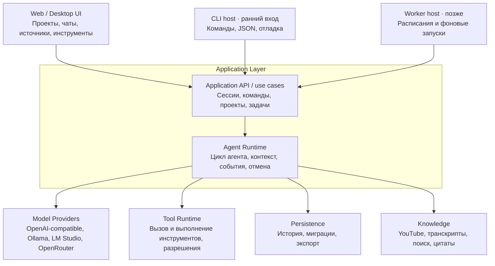

# Architecture

**Статус:** документ разделяет текущую реализацию и целевые направления. Внутренний application API и headless-first вход утверждены в ADR-0001. Целевые схемы ниже не означают, что описанные модули, пути или контракты уже реализованы.

## Текущая реализация

В репозитории реализован headless-путь: CLI вызывает application use cases, application сохраняет пользовательское сообщение, core получает ответ provider, application сохраняет финальный ответ, а JSON-хранилище позволяет прочитать историю следующим процессом. Core/application реализуют ограниченный цикл с одним переданным инструментом и проверкой разрешений. CLI по умолчанию не передаёт tools; `demo.add` подключается явными флагами.

```text
apps/cli/src/main.ts
packages/application/src/{errors,index,ports,use-cases}.ts
packages/core/src/{agent-runtime,session}.ts
packages/providers/src/{fake-provider,lm-studio-provider}.ts
packages/storage/src/{errors,index,json-file-session-repository,store-format}.ts
tests/{application,cli,providers,storage}/
```

В текущем срезе нет UI, сущности проекта, событийного журнала, record/replay, фонового worker или функций поиска по знаниям. Реальный provider — LM Studio; fake provider нужен для детерминированного текстового хода и проверки ограниченного вызова тестового инструмента. Детали реализованных API, ошибок и формата данных находятся в [CONTRACTS.md](CONTRACTS.md).

## Целевая модель

Один модульный монолит с единым application layer и строгими границами ответственности. Не микросервисы и не набор абстрактных слоёв. Каждый host вызывает application API в своём процессе; отдельный HTTP-сервер для этого не нужен. UI и CLI принимают команды, agent runtime управляет ходом агента, а адаптеры связывают его с моделями, инструментами, хранилищем и знаниями.



Диаграмма описывает целевые роли, а не текущий поток кода. Провайдеры и названия вендоров — примеры направлений адаптеров, не выбор поставщика или библиотеки. CLI — единственный реализованный host. Web/Desktop UI и worker остаются будущими сценариями; размещение UI по процессам и способ упаковки не выбраны.

## Целевые области и возможное размещение

```text
.
├── apps/
│   ├── cli/
│   │   └── src/main.ts                  # реализовано
│   ├── web/                             # не реализовано
│   └── worker/                          # отложен до сценария фоновых задач
├── packages/
│   ├── application/
│   │   └── src/                         # реализовано
│   ├── core/
│   │   └── src/                         # agent-runtime.ts и session.ts реализованы
│   ├── providers/
│   │   └── src/                         # fake-provider.ts и lm-studio-provider.ts реализованы
│   ├── storage/
│   │   └── src/                         # JSON-файловый адаптер реализован
└── tests/                               # application, CLI, providers, storage
```

Это ориентир каталогов, а не план немедленного создания всех перечисленных каталогов. Tool-calling и YouTube-функция пока не закреплены за отдельным пакетом или plugin-системой. Новые границы и пути следует выбирать вместе с конкретным сквозным сценарием. Текущее хранилище — версионируемый JSON-файл; SQLite не выбран.

## Целевые ответственности модулей

Таблица описывает желаемые границы по мере появления сценариев. Сейчас реализованы только CLI, application, core, providers и storage из текущей структуры выше.

| Модуль | Отвечает за | Не должен знать |
| --- | --- | --- |
| UI (`apps/web`, desktop host) | Отображение состояния; пользовательский ввод; отправку команд | Внутренности цикла агента, SQL и формат API конкретной модели |
| CLI (`apps/cli`) | Headless-команды, скриптовое управление, структурированный вывод и коды завершения | Собственную реализацию agent loop, прямое управление БД и обход проверок разрешений |
| Application API / application layer | Создание проектов и сессий; команды чата и задач; связывание входов с runtime и портами | UI-компоненты, транспорт HTTP и детали сетевого протокола провайдера |
| Core / Agent Runtime | Ход сессии, сбор контекста, ответы модели, вызовы инструментов, события и отмена | React, SQLite, OpenRouter, YouTube и другие конкретные адаптеры |
| Providers | Преобразование внутреннего запроса в формат модели и нормализация ответа обратно | UI, хранение чатов и бизнес-логика приложения |
| Tools | Регистрация и выполнение инструментов; проверка разрешений до побочного эффекта | Представление UI и внутренний формат API модели |
| Storage | Запись, чтение, миграции и экспорт сохранённых данных | Правила цикла агента и детали провайдеров |
| Knowledge | Получение и поиск источников, выдача контекста и ссылок/цитат | Внутренности UI и конкретная реализация agent loop |

## Целевое направление зависимостей

- UI вызывает application layer через команды и подписывается на состояние/события.
- Application layer использует core и порты инфраструктуры.
- Core зависит от внутренних типов и интерфейсов портов; конкретные адаптеры подключаются снаружи.
- Provider adapter реализует порт модели; storage adapter реализует порты чтения/записи; tool runtime реализует реестр/исполнение инструментов с проверкой разрешений.
- Внешние источники данных подключаются через явную границу; конкретная форма подключения YouTube пока не выбрана.
- Адаптеры не импортируют UI. Core не импортирует SDK провайдера, драйвер SQLite или реализацию конкретного источника/инструмента.

Практическая проверка границ: смена SQLite не меняет agent loop; смена провайдера не переписывает чат; смена UI не меняет историю или runtime.

## Application API и входы: текущее и будущее

Текущий `packages/application` предоставляет `createSession`, `sendMessage`, `runAgentTurn` и `getHistory`. Это внутренняя граница use cases; тесты могут вызывать её напрямую с fake provider и тестовым хранилищем. `createProject` и `replaySession` не реализованы.

- CLI — ранний headless host и единственный пользовательский вход первого сквозного среза. Команды позволяют создать сессию, сохранить сообщение без модели, выполнить один ход с явным `--provider fake` или `--provider lm-studio` и прочитать историю. Он вызывает application API, поддерживает JSON-вывод и стабильные коды завершения.
- Будущий web host должен вызывать те же use cases; если он окажется в отдельном процессе, способ связи потребуется отдельно решить.
- Worker отложен до фонового сценария. Он должен вызывать те же use cases, а не реализовывать собственный цикл агента.
- Сейчас есть unit/integration-тесты application, storage и providers, а также CLI process-тесты. CLI проверяет реальный процесс и постоянное хранилище между запусками.
- HTTP API не реализован и добавляется только при появлении удалённого клиента или границы процессов.

Команды `provider test`, `eval`, `trace`, `serve`, scheduler и сетевой API не реализованы; их необходимость оценивается отдельно при появлении сценариев.

## Ограниченный agent loop

```text
application сохраняет user message
  → runtime передаёт историю и доступный инструмент provider
  → provider возвращает финальный текст или один tool call
  → runtime проверяет имя и аргументы, получает allow
  → инструмент выполняется, результат добавляется во временный контекст
  → runtime вызывает provider ещё раз без доступных tools
  → application сохраняет только финальный assistant message
```

В реализованном срезе за ход можно передать максимум один инструмент. Runtime делает максимум два вызова модели и один вызов инструмента. Он проверяет имя и аргументы, затем запрашивает разрешение; выполнение происходит только при явном `allow`. Неизвестный инструмент, неверные аргументы, отказ, сбой инструмента или provider и превышение лимита завершают ход без финального сообщения ассистента.

Application API сохраняет сообщение пользователя, передаёт историю runtime и сохраняет только финальный текст ассистента. Reasoning возвращается отдельно как временный результат хода, показывается CLI и не сохраняется в истории. Tool call и результат живут во временном контексте модели. При ошибке остаётся пользовательское сообщение без ответа ассистента. Fake provider позволяет детерминированно проверить цепочку «tool call → результат → финальный ответ». LM Studio преобразует один OpenAI-compatible вызов функции и промежуточную пару assistant/tool. CLI передаёт пустой список tools по умолчанию; с `--tool demo.add` добавляет только встроенный инструмент, а исполнение разрешает только с отдельным `--allow-tool demo.add`.

Хранилище v2 допускает сообщения `user` и `assistant`. Валидный v1 читается без изменения файла и мигрируется при первой записи; исходник сохраняется как `store.json.v1.bak` до атомарной замены. Неизвестный и повреждённый формат отклоняется без автоматического сброса.

## Record/replay (целевое направление, не реализовано)

Запись упорядоченных событий сессии и воспроизведение через fake provider и mock-инструменты могут дать детерминированную проверку agent loop. Это направление не реализовано. Формат событий, payload, маскирование секретов и совместимость требуют отдельного решения.

## Целевые проверки

Текущий набор содержит тесты для application use cases, JSON storage, providers и CLI-процессов. Эта документация не утверждает, что они проходили в текущем запуске. Для будущего agent loop живые модели не нужны в основном детерминированном наборе; smoke-проверки providers выполняются отдельно.

| Уровень | Пример проверки |
| --- | --- |
| Unit | Application API с scripted fake provider выполняет один разрешённый вызов тестового инструмента и сохраняет только финальный ответ; отказ и лимиты не запускают повторное исполнение. |
| Contract | LM Studio adapter преобразует текстовую историю и один tool call в Chat Completions request и проверяет ответ. |
| Integration | Полная история сессии сохраняется и восстанавливается после перезапуска приложения. |
| CLI process | Один CLI-процесс выполняет ход через fake provider или локальную HTTP-заглушку LM Studio; следующий процесс читает сообщения пользователя и ассистента в том же порядке. |
| Replay | Формат событий и воспроизведение хода остаются будущим сценарием. |
| E2E | Можно создать проект, отправить сообщение, переключить модель и открыть старый чат. |
| Security | Запрещённая команда не исполняется без нужного решения permission policy. |

Дополнительно проверяются прерывание streaming, сетевые ошибки, некорректный tool call, закрытие приложения во время операции, миграции БД, повторная отправка сообщения и восстановление после сбоя. Такие сценарии должны опираться на управляемые fake зависимости там, где это возможно.
