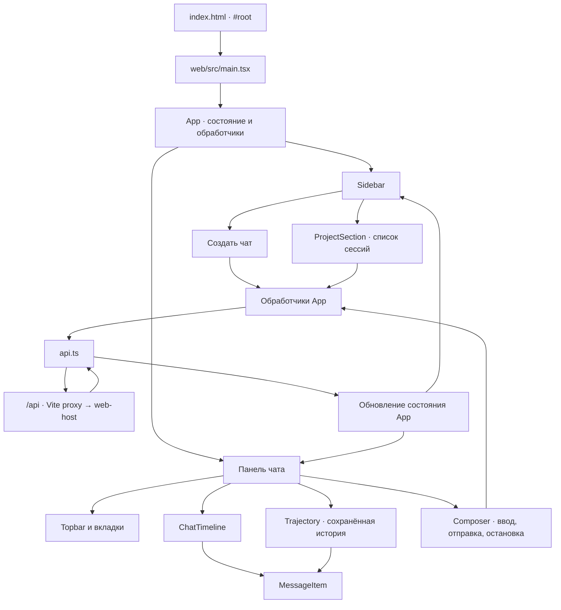
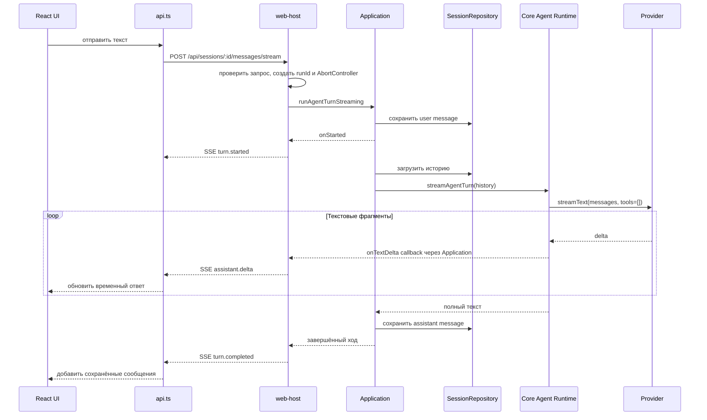
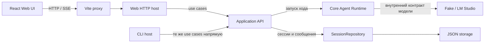

# Onboarding: приложение и архитектура

Карта текущего приложения: как запустить Web UI, как проходит запрос и где менять поведение. Описана реализованная система, а не целевая модель.

## Быстрый запуск Web UI

Установите зависимости отдельного Web-пакета и запустите API host:

```sh
npm install --prefix src/apps/web
npm run web:host
```

Во втором терминале запустите Vite:

```sh
npm run --prefix src/apps/web dev
```

Откройте адрес, который напечатает Vite. Fake provider используется по умолчанию. Для LM Studio задайте `SMYS_PROVIDER=lm-studio` и `LM_STUDIO_MODEL`; endpoint задаётся через `LM_STUDIO_ENDPOINT`, а токен — через `LM_API_TOKEN`. Каталог JSON-хранилища можно изменить через `SMYS_DATA_DIR`.

Vite проксирует `/api` в `http://127.0.0.1:3001`. Адрес API можно переопределить через `SMYS_API_URL`, порт host — через `SMYS_WEB_PORT`. Host слушает только loopback-интерфейс. Пока он работает, CLI и другие процессы не должны параллельно записывать в тот же JSON store.

## Точки входа

| Host | Точка входа | Роль |
| --- | --- | --- |
| Web UI | `src/apps/web/src/main.tsx` | Монтирует React `App` в DOM-элемент `#root`. |
| Web HTTP host | `src/apps/web-host/main.ts` | Создаёт repository и provider, запускает локальный HTTP API. |
| CLI | `src/apps/cli/main.ts` | Разбирает CLI-команды и напрямую вызывает те же Application use cases. |

Браузерный UI не импортирует Application или Core. Его выходная граница — HTTP API. Vite proxy соединяет браузер с отдельным Node host; host вызывает Application use cases.

## UI-компоненты и состояние

`App` владеет списком и выбором сессии, загруженной историей, состоянием отправки, временным ходом, ошибками и отметками об отмене. Компоненты получают состояние и callbacks через props.



При загрузке `App` запрашивает список сессий и выбирает первую, затем загружает её историю. Создание чата и отправка сообщения идут через `api.ts`. Во время генерации текст отображается из временного состояния; после успешного завершения UI добавляет сохранённые сообщения в историю и обновляет список сессий.

## Поток сообщения через HTTP, Application и Core



При ошибке хода host передаёт `turn.failed`. При остановке UI вызывает `AbortController.abort()`; разрыв запроса доходит до host, Application, Core и provider. Частичный текст остаётся временным состоянием UI и в хранилище не записывается. Если генерация завершается ошибкой после сохранения user message, в истории остаётся это сообщение без ответа ассистента.

## Ответственность слоёв

| Слой | Ответственность | Основные файлы |
| --- | --- | --- |
| Web UI | Отображение сессий и сообщений, ввод пользователя, локальное состояние текущего хода | `src/apps/web/src/{main.tsx,App.tsx,api.ts,styles.css}` |
| Web host | HTTP/SSE transport, конфигурация provider и хранилища, сериализация изменяющих запросов | `src/apps/web-host/{main.ts,server.ts}` |
| CLI host | CLI-команды, конфигурация и скриптовый вывод | `src/apps/cli/` |
| Application | Use cases сессий и ходов; связывает Core с repository/provider портами | `src/packages/application/` |
| Core | Типы сообщений и provider-agnostic agent runtime, проверки tool calls и разрешений | `src/packages/core/` |
| Providers | Адаптеры Fake и LM Studio к контракту Core | `src/packages/providers/` |
| Storage | JSON repository и формат сохранённых сессий | `src/packages/storage/` |



## Текущее поведение и ограничения

- Web host предоставляет `GET /api/sessions`, `POST /api/sessions`, `GET /api/sessions/:id/history`, `POST /api/sessions/:id/messages` и потоковый `POST /api/sessions/:id/messages/stream`.
- Web UI использует streaming route. В текущем Web-потоке доступны сохранённые текстовые сообщения и временный текстовый delta-поток. Tool calls, reasoning и runtime events не показываются в UI и не сохраняются как trajectory.
- Core поддерживает ограниченный цикл с инструментом, но Web host не передаёт инструменты в вызовах хода. Streaming use case явно отклоняет настроенные инструменты. CLI может подключить `demo.add` отдельными флагами и разрешить его отдельным флагом.
- Streaming ход сохраняет user message до генерации, а assistant message — только после полного успешного ответа. Отмена или ошибка не сохраняет частичный ответ.
- UI группирует сессии под «Без проекта». Проекты и отдельный Desktop UI не реализованы. Вкладка «История» показывает сохранённые сообщения сессии, а не runtime trace.
- Web host сериализует изменяющие запросы в одном процессе. Конкурентная запись из CLI или другого процесса в тот же JSON store не гарантируется.

## Куда идти за изменением

- Разметка, интерактивное состояние или responsive UI — `src/apps/web/src/App.tsx` и `styles.css`.
- HTTP-вызовы и обработка SSE в браузере — `src/apps/web/src/api.ts`.
- HTTP-маршруты, SSE-события и отмена запроса — `src/apps/web-host/server.ts`.
- Конфигурация host, provider и repository — `src/apps/web-host/main.ts`.
- Порядок действий при отправке сообщения и сохранении хода — `src/packages/application/use-cases.ts`.
- Агентный цикл, лимиты и исполнение tool calls — `src/packages/core/agent/runtime.ts`.
- Контракт конкретной модели — соответствующий адаптер в `src/packages/providers/`.
- Чтение и запись сессий — `src/packages/storage/` и `src/packages/application/ports.ts`.

Подробные границы модулей и контракты описаны в [`docs/ARCHITECTURE.md`](../ARCHITECTURE.md) и [`docs/CONTRACTS.md`](../CONTRACTS.md). Команды разработки и полный локальный запуск приведены в [`README.md`](../../README.md).
