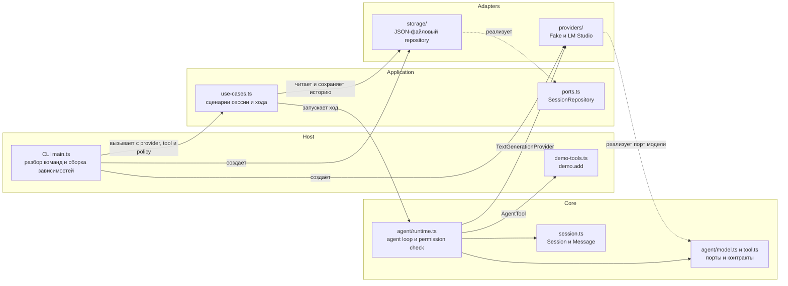

# Onboarding: структура приложения

Краткая карта текущей реализации: откуда запускается приложение, за что отвечают слои и куда идти при изменении поведения.

## Точка входа

Основной вход CLI — [`src/apps/cli/main.ts`](../../src/apps/cli/main.ts). Команда `npm run cli` сначала собирает TypeScript через `precli`, затем запускает `dist/src/apps/cli/main.js`.

`main.ts` разбирает команду и флаги, читает конфигурацию окружения, создаёт JSON-хранилище и выбранный provider, вызывает application use case и формирует текстовый или JSON-ответ. `src/apps/cli/smoke-lm-studio.ts` — отдельная команда проверки соединения с LM Studio.

## Слои

| Слой | Ответственность | Основные файлы |
| --- | --- | --- |
| CLI / host | Команды, флаги, конфигурация, пользовательский вывод и коды завершения | `src/apps/cli/` |
| Application | Сценарии приложения и порядок операций; связывает runtime с портами | `src/packages/application/use-cases.ts`, `ports.ts`, `index.ts` |
| Core | Типы сессии и provider-agnostic цикл агента, контракты модели и инструментов, проверки разрешений | `src/packages/core/session.ts`, `src/packages/core/agent/` |
| Providers | Адаптеры внутреннего контракта модели к Fake и LM Studio | `src/packages/providers/fake-provider.ts`, `lm-studio-provider.ts` |
| Storage | JSON-файловая реализация repository, формат данных и миграция | `src/packages/storage/json-file-session-repository.ts`, `store-format.ts` |

`application/index.ts`, `core/agent/index.ts` и `storage/index.ts` экспортируют API своих модулей. Runtime Core не зависит от CLI, конкретной модели или файлового хранилища. Application использует repository и provider через их контракты.

## Схема текущей реализации



## Поток выполнения хода агента

```text
CLI main
  → application.runAgentTurn
      → сохраняет сообщение пользователя и загружает историю
      → core/agent/runtime.runAgentTurn
          → вызывает provider
          → при tool call проверяет аргументы и разрешение, выполняет инструмент
          → возвращает финальный ответ и reasoning
      → сохраняет ответ ассистента
  → CLI формирует вывод
```

Tool call и его результат добавляются во временный контекст модели. В хранилище остаются сообщение пользователя и финальный ответ ассистента. Если ход завершается ошибкой, пользовательское сообщение сохраняется без ответа ассистента.

## Куда идти за изменением

- Изменить команды или формат CLI-вывода — `src/apps/cli/main.ts`.
- Изменить порядок действий при создании сессии, отправке сообщения или ходе агента — `src/packages/application/use-cases.ts`.
- Изменить repository port или настройки исполнения инструмента — `src/packages/application/ports.ts`.
- Изменить цикл агента, лимиты, проверки ответа модели или сбор reasoning — `src/packages/core/agent/runtime.ts`.
- Изменить внутренние контракты модели, ошибок или инструментов — соответствующий файл в `src/packages/core/agent/`.
- Изменить преобразование запроса или ответа конкретной модели — файл адаптера в `src/packages/providers/`.
- Изменить JSON-формат, запись, чтение или миграцию — `src/packages/storage/`.

## Текущие ограничения

- Реализованный host — CLI; desktop UI и worker пока отсутствуют.
- За ход выполняется максимум два вызова модели и один вызов инструмента. Runtime принимает один инструмент; LM Studio adapter отклоняет ответы с несколькими вызовами инструментов.
- CLI не подключает инструменты по умолчанию. `demo.add` включается явно, а исполнение требует отдельного разрешения.
- Хранилище — версионируемый JSON-файл; store сохраняет только user- и assistant-сообщения.

Подробная архитектура и контракты описаны в [`docs/ARCHITECTURE.md`](../ARCHITECTURE.md) и [`docs/CONTRACTS.md`](../CONTRACTS.md).
